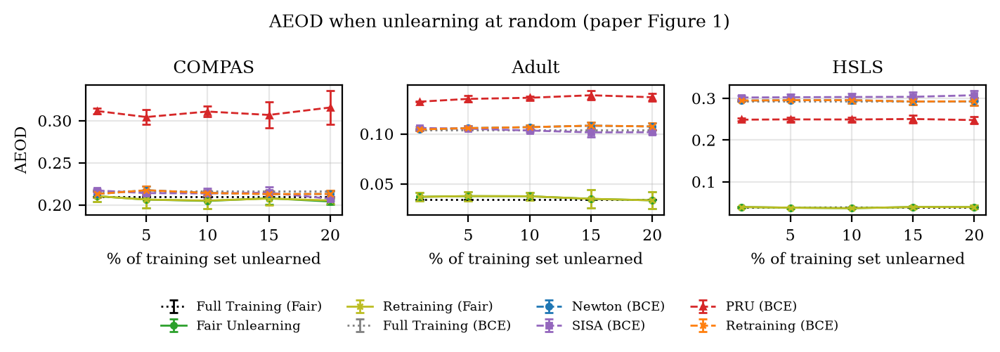

# Efficient and Fair Machine Unlearning: Newton-Based Data Removal, Demographic Fairness, and Multi-Dataset Evaluation

A reproduction of *Fair Machine Unlearning: Data Removal while Mitigating
Disparities* (Oesterling, Ma, Calmon, Lakkaraju, AISTATS 2024)
[[paper](https://proceedings.mlr.press/v238/oesterling24a.html),
[arXiv](https://arxiv.org/abs/2307.14754),
[official code](https://github.com/AI4LIFE-GROUP/fair-unlearning)],
for SJSU CMPE 257 (Machine Learning), Fall 2026.

When someone asks for their data to be deleted, a model has to "unlearn" it.
Retraining from scratch is exact but slow; one Newton step from the trained
model is fast and nearly exact. The paper shows that the standard Newton
method cannot unlearn from a model trained with a **fairness** penalty, because
that penalty compares pairs of people across demographic groups, and proposes
**Fair Unlearning**: a Newton update that accounts for those pairwise terms, with
a provable (ε, δ) unlearning certificate and a bound on how much fairness can
change.

We reproduce the paper's full experimental setup on all three datasets
(Adult, COMPAS, HSLS) and validate our implementation against the authors' code.

## Results at a glance

- **The paper's main claim reproduces.** Fair Unlearning tracks fair retraining
  within 0.0013 AEOD and 0.0004 accuracy in every dataset and deletion
  setting (averages over the 5 repeats; single repeats differ by up to
  0.0065 AEOD and 0.0028 accuracy), and stays fairer than unlearning methods built for the plain
  (BCE) loss: AEOD at 5% random deletion is 0.038 vs. 0.106 (Adult),
  0.038 vs. 0.295 (HSLS) and 0.206 vs. 0.217 (COMPAS, where the gap is
  small on this split).
- **Speed:** about 3–20× faster than retraining (paper: 2–20×); single
  timings on CPU, so the exact factors vary between runs and machines.
- **Accuracy** is below the paper's on COMPAS and HSLS (random deletion,
  Table 4): COMPAS by 1.4–3.9 points (Full Training: BCE 0.616 vs. 0.652,
  Fair 0.631 vs. 0.647), HSLS by 0.8–1.6 points (Full Training (Fair) 0.698 vs. 0.713).
  Adult is within 0.4 points. On our COMPAS split the fair model is *more*
  accurate than BCE (the paper has the reverse); across five re-drawn splits
  the order flips (fair ahead on 3 of 5) and COMPAS accuracy ranges from
  0.59 to 0.68, so this is split noise rather than a systematic difference.
- **Validation:** 48 / 48 checks against the official code pass on identical
  inputs. We also found six differences in the official code (below); with
  them fixed, its update steps reproduce ours, and ours land about 2–900×
  closer to the retrained model.
- **PRU baseline** follows the paper's code, including its ridge λ in the
  hat matrix. That ridge is about n times weaker than the regularization of
  the model being unlearned, which is why PRU lands far from retraining here
  and in the paper (e.g. COMPAS accuracy 0.688 vs. 0.652 in the paper's
  Table 4); see difference 6 below.
- **Fairness–accuracy tradeoff (App. A.9):** raising γ lowers AEOD at a
  small accuracy cost until the curve flattens: HSLS 0.30 → 0.037 AEOD for
  0.713 → 0.697 accuracy (γ = 0 → 10), Adult 0.100 → 0.013 for 0.819 → 0.814
  (γ = 0 → 0.1). COMPAS barely moves until γ = 100 (0.219 → 0.038 AEOD, but
  accuracy 0.628 → 0.573). The curve is not monotone in γ: on Adult, γ ≥ 1
  (the paper's choice) gives AEOD ≈ 0.045, worse than γ = 0.1, and on COMPAS
  γ = 1000 costs accuracy without improving AEOD further. After unlearning
  5% of the data, Fair Unlearning stays on the same curve (within the error
  bars) at every γ. We could not read the paper's figure for this
  appendix, so this is compared only qualitatively.
- **Split variance:** the paper repeats each experiment on one fixed
  train/test split. Re-drawing the split per seed widens COMPAS error bars
  from ±0.010 to ±0.087 AEOD, so split choice matters far more than which
  rows are deleted.
- **Certificate estimate:** with the paper's noise (σ = 1), the post-hoc ε at
  δ = 1e-4 ranges from 0.4 (HSLS, 1% random deletion) to 1.1e4 (Adult, 10%
  minority deletion); most settings at 5% or more are above 10. See "Noise
  and certificate" for why these are estimates, not formal guarantees.
- **Reproducible:** re-running every command below with the pinned
  environment regenerates all committed CSVs, tables and figures exactly;
  only the measured runtimes change.



Full tables, with the paper's numbers alongside ours:
[accuracy (random)](experiments/results/report/tables/accuracy_random.md),
[accuracy (minority)](experiments/results/report/tables/accuracy_minority.md),
[accuracy (majority)](experiments/results/report/tables/accuracy_majority.md),
[runtime](experiments/results/report/tables/runtime.md),
[approximation quality](experiments/results/report/tables/approximation.md),
[certificates](experiments/results/report/tables/certificate.md),
[validation](experiments/results/validation/official_comparison.md).

## What is reproduced

| Paper | Ours | Script |
|---|---|---|
| Fig. 1, Fig. 3: AEOD for random, minority and majority deletion | `report/figures/fig1_aeod_random`, `fig3_aeod_subgroups` | `run_deletion_sweep.py` → `make_report.py` |
| Fig. 2: accuracy and ε vs. noise σ | `report/figures/fig2_noise` | `run_noise_sweep.py` → `make_report.py` |
| Figs. 5–7: demographic parity, equality of opportunity, subgroup accuracy | `report/figures/fig5–7_*` | `run_deletion_sweep.py` → `make_report.py` |
| Tables 4–6: test accuracy | `report/tables/accuracy_*` | `make_report.py` |
| Table 2: runtime | `report/tables/runtime` | `make_report.py` |
| App. A.9: fairness–accuracy tradeoff over γ | `report/figures/fig4_fairness_tradeoff` | `run_fairness_tradeoff.py` → `make_report.py` |
| Methods: Fair Unlearning, Retraining (Fair/BCE), Newton, SISA, PRU, Full Training (Fair/BCE) | all eight | `src/unlearning/` |

All figures and tables are under `experiments/results/report/`.

## Paper equations → code

| Paper | Code |
|---|---|
| Eq. 1, AEOD (and DP, EOpp, subgroup accuracy, App. A.10) | `src/evaluation/metrics.py` (`compute_metrics`) |
| Eq. 2–4, fair objective; Sec. 4.2 noise term bᵀθ | `src/objectives/fair_loss.py` (`fair_logistic_loss`) |
| Eq. 7–8, Fair Unlearning step (γ = 0: Guo et al. Newton) | `src/unlearning/newton.py` (`newton_unlearn`) |
| Lemma 1 / Eq. 13, Theorem 1 bound (reference only) | `src/unlearning/certificate.py` (`theorem_eps_prime`) |
| App. A.2 / Eq. 35, data-dependent bound | `src/unlearning/certificate.py` (`data_dependent_eps_prime`) |
| Lemma 2, ε from ε′, σ, δ | `src/unlearning/certificate.py` (`epsilon_from_eps_prime`) |
| Sec. 5.1 baselines SISA, PRU | `src/unlearning/baselines.py` |
| Sec. 5.1–5.2 and App. A.6 protocol, Table 1 hyperparameters | `experiments/run_deletion_sweep.py` (`PAPER_HYPERPARAMS`, `DELETION_RATES`) |
| App. A.9, fairness–accuracy tradeoff over γ | `experiments/run_fairness_tradeoff.py` (`GAMMAS`) |

## Method

**Fair objective** (paper Eq. 2–4). Logistic regression with an L2 penalty and
the convex fairness penalty of Berk et al. (2017):

$$
\mathcal{L}(\theta, D) = \frac{1}{n}\sum_{i=1}^{n} \ell(\theta, x_i, y_i)
  + \frac{\lambda}{2}\lVert\theta\rVert^2
  + \gamma \Big( \frac{1}{n_a n_b} \sum_{i \in G_a} \sum_{j \in G_b}
      \mathbb{1}[y_i = y_j]\,(\langle x_i, \theta\rangle - \langle x_j, \theta\rangle) \Big)^2
$$

The penalty compares every pair of people from different groups who share a
true label, which targets Equalized Odds. Because each person appears in many
pairs, the loss is not a sum of per-person terms, which is what breaks
standard Newton unlearning.

**Fair Unlearning** (Eq. 7–8). After deleting rows R, take one Newton step from
the trained model θ* toward the optimum on the remaining data D' = D \ R:

$$
\theta^- = \theta^* - H^{-1} \nabla \mathcal{L}(\theta^*, D'), \qquad
H = \nabla^2 \mathcal{L}(\theta^*, D')
$$

We compute the gradient and Hessian of the full objective on D' exactly (with
automatic differentiation), which handles the pairwise terms and equals the
paper's Δ (Eq. 7). With γ = 0 this is the Newton method of Guo et al. (2020).

**Noise and certificate** (Thm. 1, Lemma 2). Training and retraining minimize
L + bᵀθ with b ~ N(0, σ²I), σ = 1, using the same b. If the unlearned model's
gradient on D' is at most ε′, unlearning is (ε, δ)-indistinguishable from
retraining with ε = √(2 ln(1.5/δ)) · ε′/σ. The paper computes ε′ with two
bounds (Theorem 1 and the data-dependent bound of App. A.2) and reports the
smaller; we use only the data-dependent bound.

The data-dependent bound is ε′ = ¼ · ‖X′‖₂ · ‖Δθ‖ · ‖X′Δθ‖ (X′ = remaining
rows including the intercept, Δθ = the unlearning step). It assumes Δθ is an
undamped Newton step on the remaining-data objective (same λ, γ and noise b),
as in our experiments; it is not valid for arbitrary parameter updates. Under
that assumption it bounds the gradient of the summed noisy loss on D′,
because only the logistic term's Hessian depends on θ; the constant it needs
is at most max|ℓ‴| · max‖x‖ ≈ 0.14 here (max|ℓ‴| = 1/(6√3) ≈ 0.096,
max‖x‖ ≤ √2), below the ¼ used. The code returns no certificate (ε = ∞) for
rows longer than about 2.6, where ¼ would no longer cover it. The Theorem 1
bound (Eq. 13) is still computed for comparison with the paper but never
used: its derivation assumes ‖x‖ ≤ 1 (our rows reach √2), drops γ from the
fairness term between Eqs. 28 and 29, and bounds ‖θ*‖ from the noise-free
stationarity condition. In all 1,316 reported settings the data-dependent
bound was already the smaller, so dropping Theorem 1 changes no reported
value.

**Our ε values are post-hoc estimates, not formal guarantees.** They are
computed from a valid bound on the remaining gradient, but three limitations
remain: (1) the lemma calibrates the noise to a bound ε′
fixed before the noise is drawn, whereas we compute ε′ after the
noise-dependent update, so each ε describes a removal budget equal to the
realized ε′ rather than a guarantee established in advance; (2) the lemma
assumes training and retraining return exact optima, while ours stop at a
gradient norm of about 1e-8; (3) preprocessing fitted before deletion
(scaling, and for HSLS imputation) is not unlearned.

**Metrics.** Absolute Equalized Odds Difference (AEOD, Eq. 1) =
½(|TPR_a − TPR_b| + |FPR_a − FPR_b|), plus absolute demographic parity,
equality of opportunity and subgroup accuracy differences, and test accuracy.

## Datasets

Preprocessing reimplements the official code and reproduces the authors'
cleaned tables value for value (see [`data/README.md`](data/README.md)).

| Dataset | Rows | Inputs (incl. intercept) | Sensitive attribute (race) | Target | γ | λ |
|---|---|---|---|---|---|---|
| Adult | 46,447 | 21 | White / Black | income > $50K | 1 | 1e-4 |
| COMPAS | 5,278 | 7 | Caucasian / African-American | is_recid | 10 | 1e-4 |
| HSLS | 14,509 | 59 | White, Asian / other | 9th-grade math test score above median (`X1TXMTH`) | 10 | 1e-2 |

Random 80/20 train/test split; every row divided by the largest training-row
norm, so training rows have ‖x‖ ≤ 1 before the intercept column is appended
(Theorem 1 assumes ‖x‖ ≤ 1; with the intercept ‖x‖ ≤ √2, and test rows can
exceed 1). Certificates use only the data-dependent bound, which remains
valid at these norms; the Theorem 1 bound does not (see "Noise and
certificate" above). Deletions are 1, 5, 10, 15, 20% of the
training set (random or majority group) and 1, 5, 10% (minority group), with
5 repeats, as in the paper. "Minority" is the smaller group in the training
set (paper Sec. 5.1: "the minority subgroup has (by definition) less
representation"), so on COMPAS it is Caucasian. For a given seed the deleted
sets are nested across rates (the 1% rows are the first rows of the same
permutation as the 5% rows, and so on).

**Two data paths.** All results use the paper-matched loaders
(`src/data/datasets.py`). The team's original loaders from the first
iteration are kept in `src/data/original/` for comparison and are selected
with `--loader original`; they differ in sensitive attribute, features, split
and scaling. See [`data/README.md`](data/README.md#two-data-paths-paper-matched-and-the-teams-original-loaders).

## Setup

With conda (recommended):

```bash
conda env create -f environment.yml
conda activate fair-unlearning
```

Or with pip: `pip install -r requirements.txt`. Both files pin the exact
versions (Python 3.12, PyTorch 2.15.0, NumPy 2.5.4, pandas 3.1.1,
scikit-learn 1.9.1) with which the full sweep was re-run and reproduced the
committed results.

All data files for the reported experiments are in the repository; nothing
needs to be downloaded. Two optional extras: the NCES HSLS student file
(only for `src/data/hsls_nces.py`, `experiments/hsls_sources.py` and the
original HSLS loader; see [`data/README.md`](data/README.md)), and the
official code clone, which `python -m validation.compare_official` fetches
into `external/` itself.

## Running

From the repository root:

```bash
python -m pytest                                    # tests (~5 s; longer with the NCES file)
python -m experiments.run_deletion_sweep            # Figs. 1, 3, 5–7, Tables 2, 4–6 data (~8 min)
python -m experiments.run_deletion_sweep --vary-split   # same, new split per seed (~8 min)
python -m experiments.run_noise_sweep               # Fig. 2 data (~20 s)
python -m experiments.run_fairness_tradeoff         # App. A.9 tradeoff over γ (~30 s)
python -m experiments.make_report                   # tables and figures (~5 s)
python -m validation.compare_official               # check against the official code (clones it into external/)
```

Times are wall-clock on a multi-core desktop CPU; PyTorch uses every core
(the deletion sweep used ~150 CPU-minutes), so on a laptop expect several
times longer. Set `OMP_NUM_THREADS` to limit it. Run the sweeps before
`make_report`.

Useful options: `--datasets compas adult`, `--quick` (1 seed), `--plot-only`,
`--sigma 0` (no noise), `--gamma` / `--lambda-reg` (override the paper's
values), `--loader original` (the team's original loaders, outputs in
`experiments/results/original_loaders/`; Adult and COMPAS run from git, HSLS
needs the NCES file).

Optional: `python -m experiments.hsls_sources` (authors' vs. NCES-built HSLS;
needs the NCES file) and the first-iteration scripts in `scripts/legacy/`
(below).

Outputs:

```
experiments/results/
├── deletion_sweep_raw_<dataset>.csv     every seed and method
├── deletion_sweep_summary.csv           mean ± std over 5 repeats
├── plots/deletion_sweep/                one plot per dataset, deletion type, metric
├── vary_split/                          same, with a new split per seed
├── original_loaders/                    same, with --loader original (Adult, COMPAS)
├── noise_sweep/                         Fig. 2 data and plots
├── fairness_tradeoff/                   App. A.9 tradeoff data and plots
├── report/{tables,figures}/             paper-style tables (Markdown, LaTeX) and figures (PDF, PNG)
└── validation/official_comparison.md    validation report
```

## Repository structure

```
src/
├── data/
│   ├── datasets.py        paper preprocessing for all three datasets
│   ├── adult.py, compas.py, hsls.py   load_adult(), load_compas(), load_hsls()
│   ├── hsls_nces.py       HSLS built independently from NCES data (load_hsls_nces)
│   └── original/          the team's original loaders (--loader original)
├── objectives/
│   ├── fair_loss.py       fair objective (+ optional noise term)
│   ├── train.py           L-BFGS training
│   └── derivatives.py     gradient and Hessian (autograd)
├── unlearning/
│   ├── newton.py          Fair Unlearning / Newton step
│   ├── baselines.py       SISA and PRU
│   └── certificate.py     (ε, δ) bounds
└── evaluation/metrics.py  accuracy and fairness metrics
experiments/
├── run_deletion_sweep.py  main experiments (all methods, all deletion settings)
├── run_noise_sweep.py     noise vs. certificate (Fig. 2)
├── run_fairness_tradeoff.py   fairness–accuracy tradeoff over γ (App. A.9)
├── hsls_sources.py        authors' vs. NCES-built HSLS (needs the NCES file)
└── make_report.py         tables and figures
validation/compare_official.py   comparison with the authors' code
tests/                     pytest suite (also run by GitHub Actions)
scripts/legacy/            first-iteration check scripts (see below)
data/                      raw data and data/README.md
LICENSE, NOTICE            Apache-2.0, attribution for the official code and data
```

## Differences from the paper and its official code

Our implementation follows the paper's equations. Comparing against the
official code on identical inputs
([report](experiments/results/validation/official_comparison.md)) found:

1. **Hessian L2 term.** The official update steps use n·λ; the Hessian of the
   loss on the remaining data has (n − k)·λ.
2. **Intercept counted twice** in the official Newton (BCE) Hessian weights.
3. **PRU** builds its gradient from the first k training rows instead of the
   deleted rows. We follow Izzo et al.'s algorithm.
4. **Precision and convergence.** The official code sums the fairness term in
   float32 and stops training after 20 L-BFGS steps without a line search,
   which does not always reach the optimum. We use float64 and train to
   convergence (gradient norm ≈ 1e-8).
5. **Certificate.** The official script divides by σ²; Lemma 2 gives ε ∝ 1/σ.
   The two agree at σ = 1 (all main results). With 1/σ, ε is lowest around
   σ = 1–10 and rises again for larger noise, which dividing by σ² hides.
6. **PRU ridge (kept as in the paper).** The official PRU builds its hat
   matrix with λ·I, but the model it unlearns minimizes the mean loss with
   λ, whose summed-loss Hessian has n·λ·I (the official Newton steps use
   n·λ). We keep λ so our PRU is the paper's baseline; it lands up to
   14–250 (HSLS–COMPAS) away from the retrained model. For reference,
   `pru_precompute(..., model_ridge=True)` uses n·λ, which brings PRU to
   within 0.34–8.4 of retraining and within about 1 accuracy point
   (validation report, PRU distance rows); it is not used for any result.

Other notes: the paper's 5 repeats re-draw only the deleted rows on one split;
`--vary-split` also re-draws the split. Runtimes are on CPU (paper: V100 GPU),
so only the speedups are comparable.

## Limitations

- Logistic regression only, as in the paper; the guarantees need a convex loss.
- One train/test split per run in the paper's protocol; COMPAS in particular
  varies a lot between splits (see `report/figures/split_variation`).
- HSLS uses the authors' preprocessed, k-NN-imputed table, not survey weights.
  Our output matches their published cleaned CSV, which validates only the
  steps after their imputation. `src/data/hsls_nces.py` builds HSLS
  independently from the NCES public-use file (14,843 students, no
  train/test leakage); see [`data/README.md`](data/README.md).
- Large ε values at high deletion rates mean the certificate estimate is weak
  there; the bound scales with the number of deleted rows. All ε values are
  post-hoc estimates, not formal guarantees (see "Noise and certificate").

## Legacy scripts (`scripts/legacy/`)

Standalone checks from the project's first iteration, now on the paper's data
setup and hyperparameters, run with `python -m scripts.legacy.<name>`:
`check_adult_data`, `check_compas_data`, `check_fair_loss`,
`check_derivatives`, `check_newton_step`, `check_retraining_comparison`,
`train_adult`, `train_compas`, `train_hsls`, and `unlearn_adult` (needs the
model written by `train_adult`, saved under the gitignored
`scripts/legacy/models/`). They are not part of the pytest suite. The first
iteration's experiment scripts and results (pre-paper data setup) were
replaced by `experiments/run_deletion_sweep.py` and remain in the git
history; their data loaders are kept in `src/data/original/`.

## References

- A. Oesterling, J. Ma, F. P. Calmon, H. Lakkaraju. *Fair Machine Unlearning:
  Data Removal while Mitigating Disparities.* AISTATS 2024.
- C. Guo, T. Goldstein, A. Hannun, L. van der Maaten. *Certified Data Removal
  from Machine Learning Models.* ICML 2020.
- Z. Izzo, M. A. Smart, K. Chaudhuri, J. Zou. *Approximate Data Deletion from
  Machine Learning Models.* AISTATS 2021.
- L. Bourtoule et al. *Machine Unlearning.* IEEE S&P 2021.
- R. Berk et al. *A Convex Framework for Fair Regression.* FAT/ML 2017.
- H. Jeong, H. Wang, F. P. Calmon. *Fairness without Imputation.* AAAI 2022
  (HSLS preprocessing).
- National Center for Education Statistics. *High School Longitudinal Study of
  2009 (HSLS:09).* https://nces.ed.gov/surveys/hsls09/

The HSLS table and the preprocessing logic come from the authors' official
code, used under the Apache License 2.0.

## License

Apache License 2.0 (see [`LICENSE`](LICENSE)); [`NOTICE`](NOTICE) lists the
material from the official code and the datasets' sources.

---

**Authors:** Ahmed Sabzwari, Omar Jamjoum, Aaron Chandler
