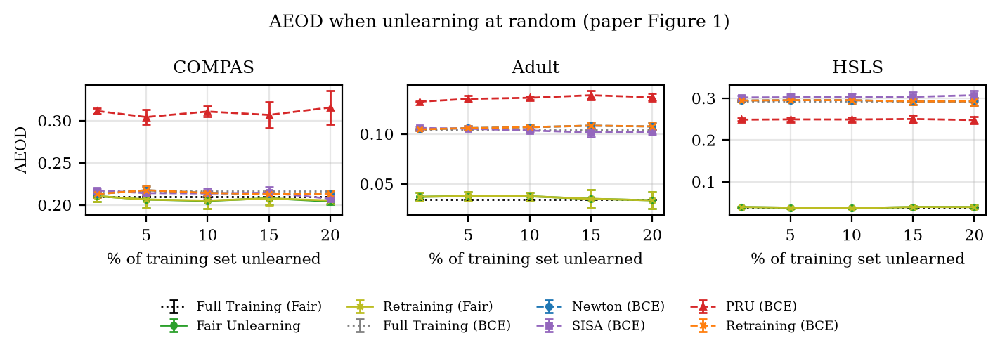

# Efficient and Fair Machine Unlearning: Newton-Based Data Removal, Demographic Fairness, and Multi-Dataset Evaluation

A reproduction of *Fair Machine Unlearning: Data Removal while Mitigating
Disparities* (Oesterling, Ma, Calmon, Lakkaraju, AISTATS 2024)
[[paper](https://proceedings.mlr.press/v238/oesterling24a.html),
[arXiv](https://arxiv.org/abs/2307.14754),
[official code](https://github.com/AI4LIFE-GROUP/fair-unlearning)],
for SJSU CMPE 257 (Machine Learning), Fall 2026.

When someone asks for their data to be deleted, a model has to "unlearn" it.
Retraining from scratch is exact but slow; one Newton step from the trained
model is fast and nearly exact. The paper shows that the standard Newton
method cannot unlearn from a model trained with a **fairness** penalty, because
that penalty compares pairs of people across demographic groups, and proposes
**Fair Unlearning**: a Newton update that accounts for those pairwise terms, with
a provable (ε, δ) unlearning certificate and a bound on how much fairness can
change.

We reproduce the paper's full experimental setup on all three datasets
(Adult, COMPAS, HSLS) and validate our implementation against the authors' code.

## Results at a glance

- **The paper's main claim reproduces.** Fair Unlearning tracks fair retraining
  within 0.0013 AEOD and 0.0004 accuracy in every dataset and deletion
  setting, and stays fairer than unlearning methods built for the plain
  (BCE) loss: AEOD at 5% random deletion is 0.038 vs. 0.106 (Adult),
  0.038 vs. 0.295 (HSLS) and 0.206 vs. 0.217 (COMPAS, where the gap is
  small on this split).
- **Speed:** 3–18× faster than retraining (paper: 2–20×).
- **Accuracy** is within about 1.5 points of the paper on Adult and HSLS;
  COMPAS is about 3 points lower, within the variation we measured across
  train/test splits.
- **Validation:** 45 / 45 checks against the official code pass on identical
  inputs. We also found five differences in the official code (below); with
  them fixed, its update steps reproduce ours, and ours land about 2–900×
  closer to the retrained model.
- **Split variance:** the paper repeats each experiment on one fixed
  train/test split. Re-drawing the split per seed widens COMPAS error bars
  from ±0.010 to ±0.087 AEOD, so split choice matters far more than which
  rows are deleted.
- **Certificate:** with the paper's noise (σ = 1), ε at δ = 1e-4 ranges from
  0.4 (HSLS, 1% deleted) to a few hundred (Adult, 20% deleted).



Full tables, with the paper's numbers alongside ours:
[accuracy (random)](experiments/results/report/tables/accuracy_random.md),
[accuracy (minority)](experiments/results/report/tables/accuracy_minority.md),
[accuracy (majority)](experiments/results/report/tables/accuracy_majority.md),
[runtime](experiments/results/report/tables/runtime.md),
[approximation quality](experiments/results/report/tables/approximation.md),
[certificates](experiments/results/report/tables/certificate.md),
[validation](experiments/results/validation/official_comparison.md).

## What is reproduced

| Paper | Ours | Script |
|---|---|---|
| Fig. 1, Fig. 3: AEOD for random, minority and majority deletion | `report/figures/fig1_aeod_random`, `fig3_aeod_subgroups` | `run_deletion_sweep.py` → `make_report.py` |
| Fig. 2: accuracy and ε vs. noise σ | `report/figures/fig2_noise` | `run_noise_sweep.py` → `make_report.py` |
| Figs. 5–7: demographic parity, equality of opportunity, subgroup accuracy | `report/figures/fig5–7_*` | `run_deletion_sweep.py` → `make_report.py` |
| Tables 4–6: test accuracy | `report/tables/accuracy_*` | `make_report.py` |
| Table 2: runtime | `report/tables/runtime` | `make_report.py` |
| Fig. 4 (App. A.9): fairness–accuracy tradeoff over γ | Task 1 (separate script) | — |
| Methods: Fair Unlearning, Retraining (Fair/BCE), Newton, SISA, PRU, Full Training (Fair/BCE) | all eight | `src/unlearning/` |

All figures and tables are under `experiments/results/report/`.

## Method

**Fair objective** (paper Eq. 2–4). Logistic regression with an L2 penalty and
the convex fairness penalty of Berk et al. (2017):

$$
\mathcal{L}(\theta, D) = \frac{1}{n}\sum_{i=1}^{n} \ell(\theta, x_i, y_i)
  + \frac{\lambda}{2}\lVert\theta\rVert^2
  + \gamma \Big( \frac{1}{n_a n_b} \sum_{i \in G_a} \sum_{j \in G_b}
      \mathbb{1}[y_i = y_j]\,(\langle x_i, \theta\rangle - \langle x_j, \theta\rangle) \Big)^2
$$

The penalty compares every pair of people from different groups who share a
true label, which targets Equalized Odds. Because each person appears in many
pairs, the loss is not a sum of per-person terms, which is what breaks
standard Newton unlearning.

**Fair Unlearning** (Eq. 7–8). After deleting rows R, take one Newton step from
the trained model θ* toward the optimum on the remaining data D' = D \ R:

$$
\theta^- = \theta^* - H^{-1} \nabla \mathcal{L}(\theta^*, D'), \qquad
H = \nabla^2 \mathcal{L}(\theta^*, D')
$$

We compute the gradient and Hessian of the full objective on D' exactly (with
automatic differentiation), which handles the pairwise terms and equals the
paper's Δ (Eq. 7). With γ = 0 this is the Newton method of Guo et al. (2020).

**Noise and certificate** (Thm. 1, Lemma 2). Training and retraining minimize
L + bᵀθ with b ~ N(0, σ²I), σ = 1, using the same b. If the unlearned model's
gradient on D' is at most ε′, unlearning is (ε, δ)-indistinguishable from
retraining with ε = √(2 ln(1.5/δ)) · ε′/σ. We compute ε′ with both of the
paper's bounds (Theorem 1 and the data-dependent bound of App. A.2) and report
the smaller, as the paper does.

**Metrics.** Absolute Equalized Odds Difference (AEOD, Eq. 1) =
½(|TPR_a − TPR_b| + |FPR_a − FPR_b|), plus absolute demographic parity,
equality of opportunity and subgroup accuracy differences, and test accuracy.

## Datasets

Preprocessing reimplements the official code and reproduces the authors'
cleaned tables value for value (see [`data/README.md`](data/README.md)).

| Dataset | Rows | Inputs (incl. intercept) | Sensitive attribute (race) | Target | γ | λ |
|---|---|---|---|---|---|---|
| Adult | 46,447 | 21 | White / Black | income > $50K | 1 | 1e-4 |
| COMPAS | 5,278 | 7 | Caucasian / African-American | is_recid | 10 | 1e-4 |
| HSLS | 14,509 | 59 | White, Asian / other | 9th-grade math grade (binary) | 10 | 1e-2 |

Random 80/20 train/test split; every row scaled to norm ≤ 1 (Theorem 1's
assumption); intercept column appended. Deletions are 1, 5, 10, 15, 20% of the
training set (random or majority group) and 1, 5, 10% (minority group), with
5 repeats, as in the paper.

## Setup

With conda (recommended):

```bash
conda env create -f environment.yml
conda activate fair-unlearning
```

Or with pip: `pip install -r requirements.txt`.

All data files are in the repository; nothing needs to be downloaded.

## Running

From the repository root:

```bash
python -m pytest                                    # tests, ~5 s
python -m experiments.run_deletion_sweep            # Figs. 1, 3, 5–7, Tables 2, 4–6 data (~30–60 min)
python -m experiments.run_deletion_sweep --vary-split   # same, new split per seed
python -m experiments.run_noise_sweep               # Fig. 2 data (~10–20 min)
python -m experiments.make_report                   # tables and figures, ~10 s
python -m validation.compare_official               # check against the official code
```

Useful options: `--datasets compas adult`, `--quick` (1 seed), `--plot-only`,
`--sigma 0` (no noise), `--gamma` / `--lambda-reg` (override the paper's values).

Outputs:

```
experiments/results/
├── deletion_sweep_raw_<dataset>.csv     every seed and method
├── deletion_sweep_summary.csv           mean ± std over 5 repeats
├── plots/deletion_sweep/                one plot per dataset, deletion type, metric
├── vary_split/                          same, with a new split per seed
├── noise_sweep/                         Fig. 2 data and plots
├── report/{tables,figures}/             paper-style tables (Markdown, LaTeX) and figures (PDF, PNG)
└── validation/official_comparison.md    validation report
```

## Repository structure

```
src/
├── data/
│   ├── datasets.py        paper preprocessing for all three datasets
│   └── adult.py, compas.py, hsls.py   load_adult(), load_compas(), load_hsls()
├── objectives/
│   ├── fair_loss.py       fair objective (+ optional noise term)
│   ├── train.py           L-BFGS training
│   └── derivatives.py     gradient and Hessian (autograd)
├── unlearning/
│   ├── newton.py          Fair Unlearning / Newton step
│   ├── baselines.py       SISA and PRU
│   └── certificate.py     (ε, δ) bounds
└── evaluation/metrics.py  accuracy and fairness metrics
experiments/
├── run_deletion_sweep.py  main experiments (all methods, all deletion settings)
├── run_noise_sweep.py     noise vs. certificate (Fig. 2)
└── make_report.py         tables and figures
validation/compare_official.py   comparison with the authors' code
tests/test_reproduction.py       pytest suite (also run by GitHub Actions)
data/                      raw data and data/README.md
```

## Differences from the paper and its official code

Our implementation follows the paper's equations. Comparing against the
official code on identical inputs
([report](experiments/results/validation/official_comparison.md)) found:

1. **Hessian L2 term.** The official update steps use n·λ; the Hessian of the
   loss on the remaining data has (n − k)·λ.
2. **Intercept counted twice** in the official Newton (BCE) Hessian weights.
3. **PRU** builds its gradient from the first k training rows instead of the
   deleted rows. We follow Izzo et al.'s algorithm.
4. **Precision and convergence.** The official code sums the fairness term in
   float32 and stops training after 20 L-BFGS steps without a line search,
   which does not always reach the optimum. We use float64 and train to
   convergence (gradient norm ≈ 1e-8).
5. **Certificate.** The official script divides by σ²; Lemma 2 gives ε ∝ 1/σ.
   The two agree at σ = 1 (all main results). With 1/σ, ε is lowest around
   σ = 1–10 and rises again for larger noise, which dividing by σ² hides.

Other notes: the paper's 5 repeats re-draw only the deleted rows on one split;
`--vary-split` also re-draws the split. Runtimes are on CPU (paper: V100 GPU),
so only the speedups are comparable.

## Limitations

- Logistic regression only, as in the paper; the guarantees need a convex loss.
- One train/test split per run in the paper's protocol; COMPAS in particular
  varies a lot between splits (see `report/figures/split_variation`).
- Fig. 4 (fairness–accuracy tradeoff over γ) is produced separately (Task 1).
- HSLS uses the authors' preprocessed, k-NN-imputed table, not survey weights.
- Large ε values at high deletion rates mean the certificate is weak there;
  the paper's bound scales with the number of deleted rows.

## Other scripts in `tests/`

Besides the pytest suite (`tests/test_reproduction.py`), `tests/` holds
standalone checks from the project's first iteration, run with
`python -m tests.<name>` (for example `python -m tests.test_fair_loss`).
`test_adult_unlearning` needs the model file written by
`python -m tests.test_adult_training`. Earlier experiment scripts and their
results, which used a pre-paper data setup, were replaced by
`experiments/run_deletion_sweep.py` and remain in the git history.

## References

- A. Oesterling, J. Ma, F. P. Calmon, H. Lakkaraju. *Fair Machine Unlearning:
  Data Removal while Mitigating Disparities.* AISTATS 2024.
- C. Guo, T. Goldstein, A. Hannun, L. van der Maaten. *Certified Data Removal
  from Machine Learning Models.* ICML 2020.
- Z. Izzo, M. A. Smart, K. Chaudhuri, J. Zou. *Approximate Data Deletion from
  Machine Learning Models.* AISTATS 2021.
- L. Bourtoule et al. *Machine Unlearning.* IEEE S&P 2021.
- R. Berk et al. *A Convex Framework for Fair Regression.* FAT/ML 2017.
- H. Jeong, H. Wang, F. P. Calmon. *Fairness without Imputation.* AAAI 2022
  (HSLS preprocessing).
- National Center for Education Statistics. *High School Longitudinal Study of
  2009 (HSLS:09).* https://nces.ed.gov/surveys/hsls09/

The HSLS table and the preprocessing logic come from the authors' official
code, used under the Apache License 2.0.

---

**Authors:** Ahmed Sabzwari, Omar Jamjoum, Aaron Chandler
